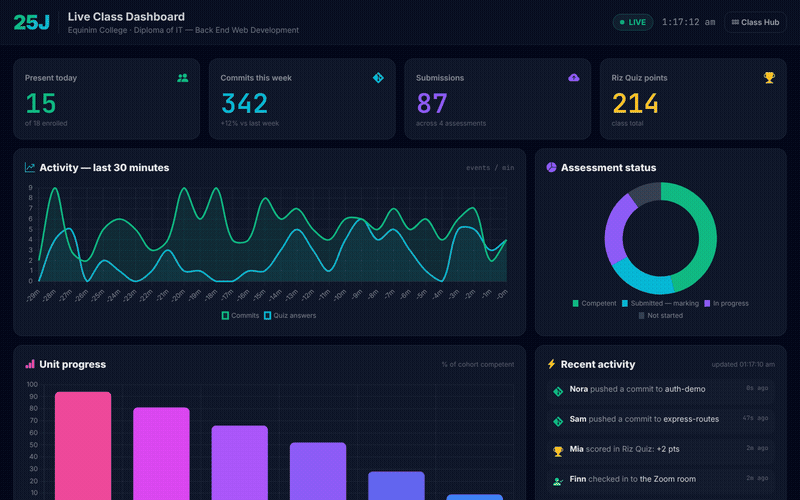
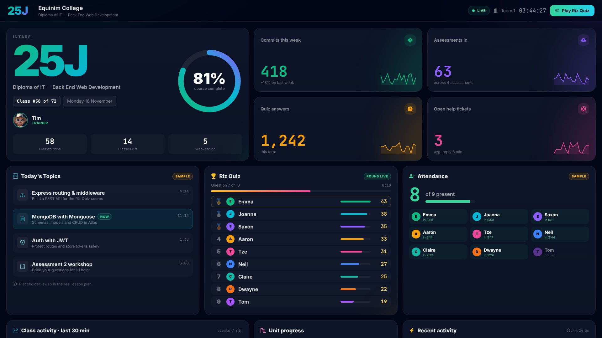
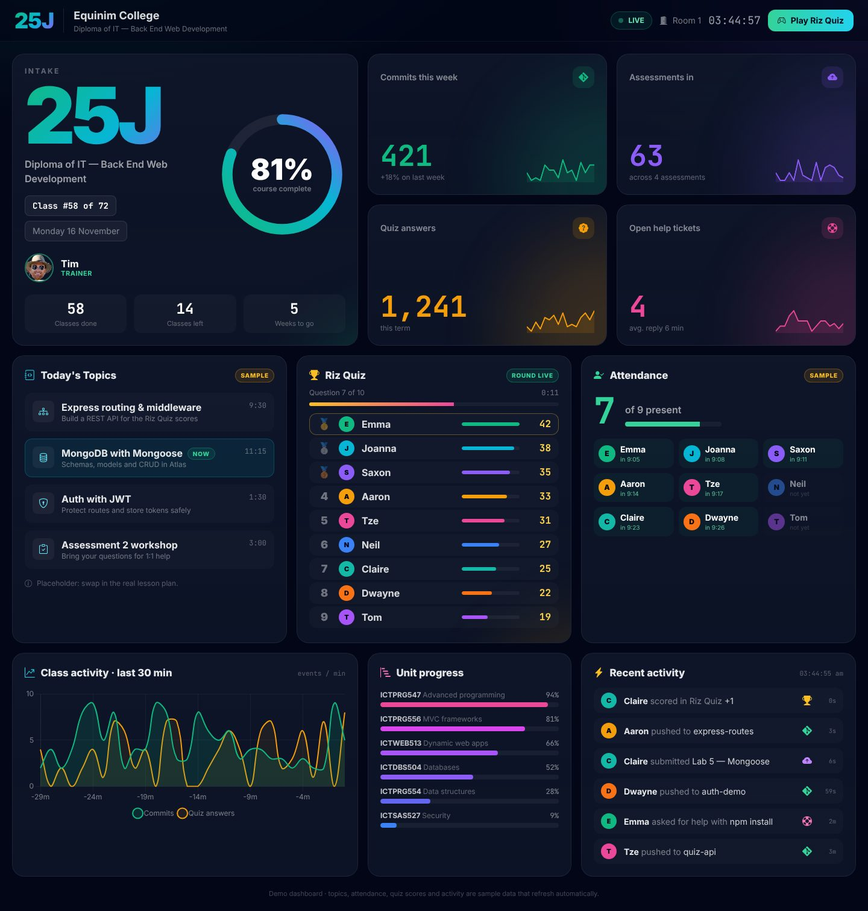
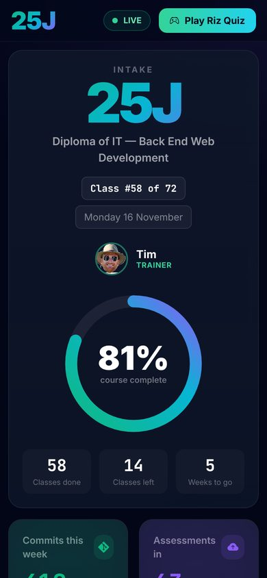

# EQC Hub — Intake 25J

> One big-screen live dashboard for Equinim College's Intake 25J (Diploma of IT — Back End Web Development): course progress, today's topics, attendance, the Riz Quiz leaderboard and class activity on a single page.

**Live demo:** [eqc-hub-25j.vercel.app](https://eqc-hub-25j.vercel.app)

     

## Features

- **Hero:** intake, course, today's class number, trainer and an animated course-progress ring (worked out from the start/end dates and class days)
- **Live KPI tiles:** commits, assessments in, quiz answers and help tickets, with count-up numbers and sparklines
- **Riz Quiz leaderboard:** nine students with a question timer; scores tick up and rows re-order with animation (`play.html` is the student game)
- **Today's Topics** and **Attendance:** styled placeholders (marked *Sample*) ready to wire to the real lesson plan and sign-in
- **Class activity chart, unit progress bars and a recent-activity feed**, all driven by mock data that refreshes every few seconds
- Responsive: big-screen grid on the classroom TV, stacked cards on a phone
- All per-intake settings (intake code, dates, class days, student names) live in one `CONFIG` object at the top of `index.html`

## Tech stack

- Plain HTML + vanilla JavaScript (no build step)
- Tailwind CSS (Play CDN), Inter + JetBrains Mono, Bootstrap Icons
- Chart.js 4 for the activity chart
- Firebase Realtime Database for the student quiz game (`play.html`)
- Hosted on Vercel as a static site

## Run it locally

```bash
git clone https://github.com/thedalycreative/eqc-hub-25J.git
cd eqc-hub-25J
python3 -m http.server 8000   # or: npx serve .
# open http://localhost:8000
```

## Deployment (Vercel)

Static site — no build command, output directory is the repo root. The Vercel project **eqc-hub-25j** is linked to this repo and deploys `main` to production at **https://eqc-hub-25j.vercel.app**. Every push to `main` redeploys; other branches get preview URLs.

To reuse for a new intake, edit `CONFIG` in `index.html` (intake code, dates, class days, students). `dashboard.html` now just redirects to the home page.

## Screenshots



<p align="center">
  
  
  
</p>

_Captured from the live site (https://eqc-hub-25j.vercel.app). Regenerate with any headless browser; files live in `docs/screenshots/`._

---

Built by [The Daly Creative](https://www.thedalycreative.com) · Perth, WA
